# GraceSpring Family Church app

#just ignore
A church app for members, leaders and admins: home feed, audio sermons, devotionals, events, prayer wall, 1 to 1 chat with voice notes, push notifications and app lock. React web app and Go API, with auth handled by a separate csag instance.

## Repository layout

```
/
  design/              static HTML/CSS/JS reference UI (read only, do not edit)
    later/             parked screens: calls, groups, community, ministries
  apps/
    api/               Go API, realtime gateway, workers (not yet created)
    web/               React web app (not yet created)
  packages/
    api-client/        generated TypeScript client (not yet created)
    shared/            shared types, validation, design tokens (not yet created)
  openapi/             the API contract (not yet created)
  deploy/              caddy/, systemd/, scripts/, backup/ (not yet created)
  docs/                architecture, build plan, workflows, decisions
```

## Docs

Start with `CLAUDE.md`, then `HANDOFF.md`, `NEXT.md` and `PROGRESS.md`. The full docs map is in `HANDOFF.md`, section 6.

Key files: `docs/BUILD_PLAN.md` (releases and acceptance criteria), `docs/FEATURES.md` (feature scope, parked features, install plan and infrastructure), `docs/FRONTEND.md` (porting the design pages), `docs/AUTH.md` (csag integration), `docs/GIT_WORKFLOW.md` (branches, commits, secret checks).

## Branches and commits

Never commit to main directly. One branch per feature: `feat/<short-name>`, holding all of that feature's work as small commits (API, web, tests, fixes and docs). Use `fix/`, `docs/` or `chore/` branches only for work that belongs to no feature. Commit often, one step per commit. Full rules in `docs/GIT_WORKFLOW.md`.

## Secret check before committing

The rules live in `docs/GIT_WORKFLOW.md`, section "Secret check before every commit". Never stage `.env` or any real credentials. Only `.env.example` files with placeholder values may be committed. A pre-commit hook script automating the check is planned under `deploy/scripts/`.

## Design preview

The `design/` folder is a clickable, front-end only preview of the whole app. It saves nothing and sends nothing. To view it:

```
cd design
python3 -m http.server 8000
```

Then open `http://localhost:8000` on a phone-sized window. Use a local server rather than opening files directly, because the share image feature draws on a canvas and browsers block that on `file://` pages.

What the preview shows on this branch:

- iOS look: system font stack, grouped lists, and a liquid glass layer (blurred translucent tab bar, sheets, buttons and chat bars) in light and dark mode.
- Home feed with text posts, quote posts and image plus text posts, each with like, comment, repost and share, and a post page with comments.
- Branded share image: any post can be shared as a picture (church frame, navy quote card, gold accent, "Share faith. Share hope.") or sent to WhatsApp or copied as a link.
- Chats like WhatsApp: message only contacts who have a GraceSpring account (others can be invited), voice notes with a mic button, photos and document upload, and an attach menu.
- GraceSpring Bot: a chat that answers questions about service times, location, giving, prayer and Bible verses.
- Phone style notification banner, a notification permission screen and notification settings.
- Our own app lock: choose Face ID, fingerprint or a PIN after sign up, then unlock from a welcome style screen.

| Home | Feed | Post |
| --- | --- | --- |
| 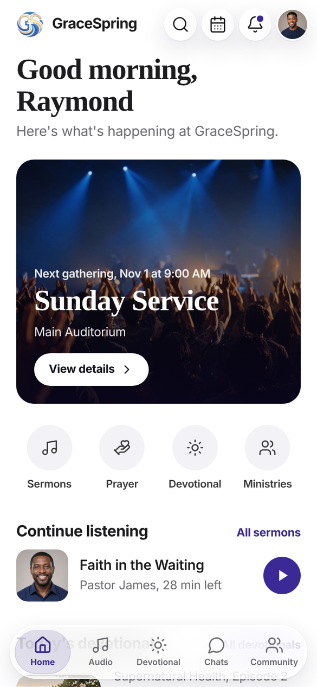 | 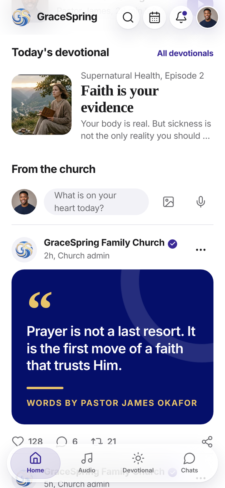 | 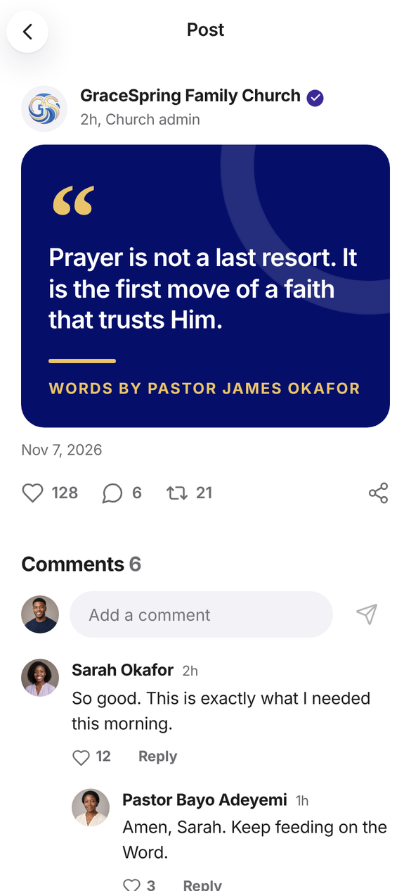 |

| Share image | Messages | Chat with voice note |
| --- | --- | --- |
| 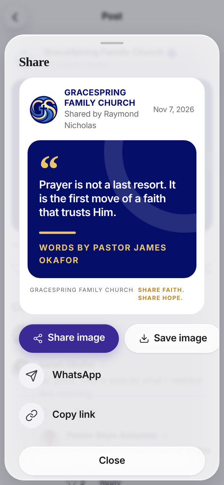 | 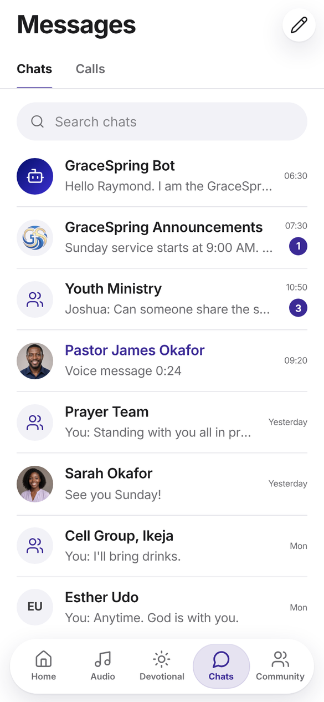 | 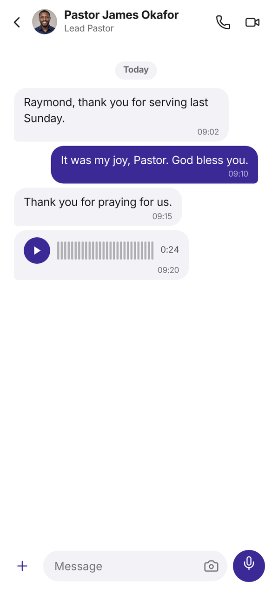 |

| GraceSpring Bot | Notification banner | Dark mode |
| --- | --- | --- |
| 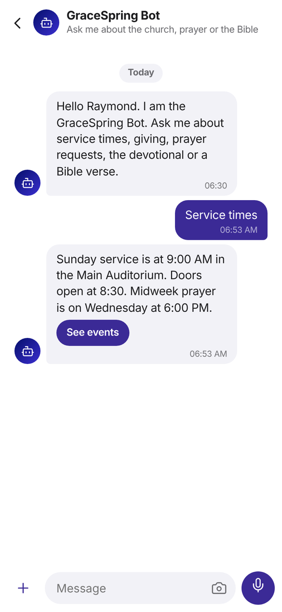 | 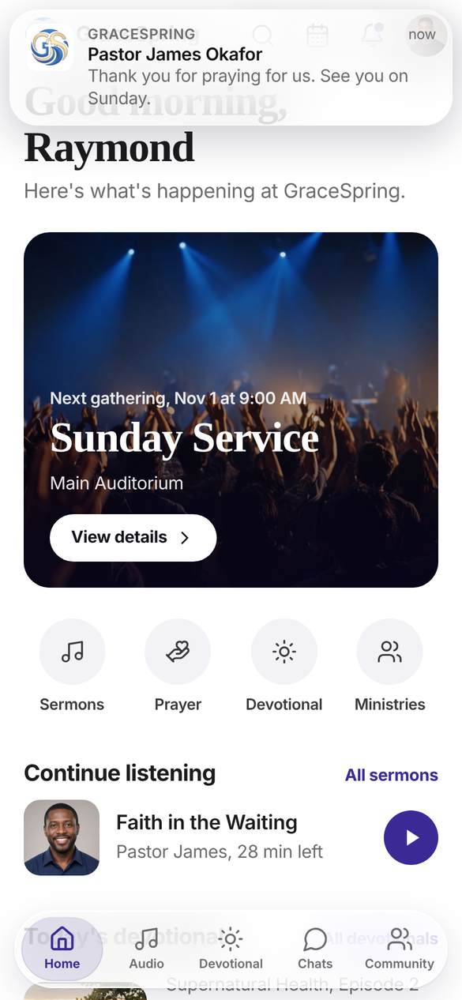 | 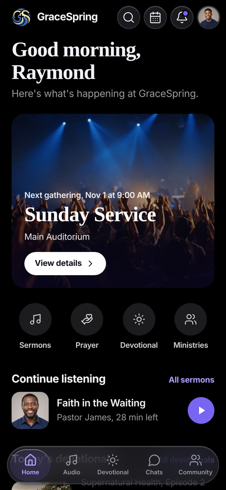 |

| Notifications | App lock setup | Unlock |
| --- | --- | --- |
| 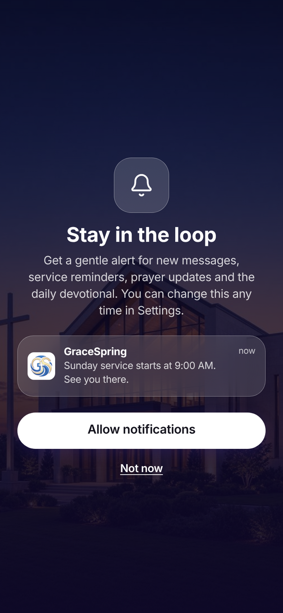 | 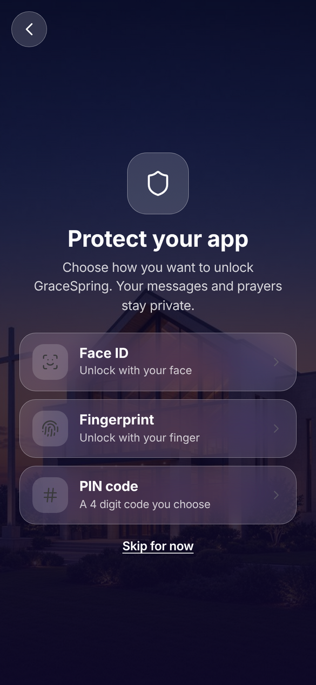 | 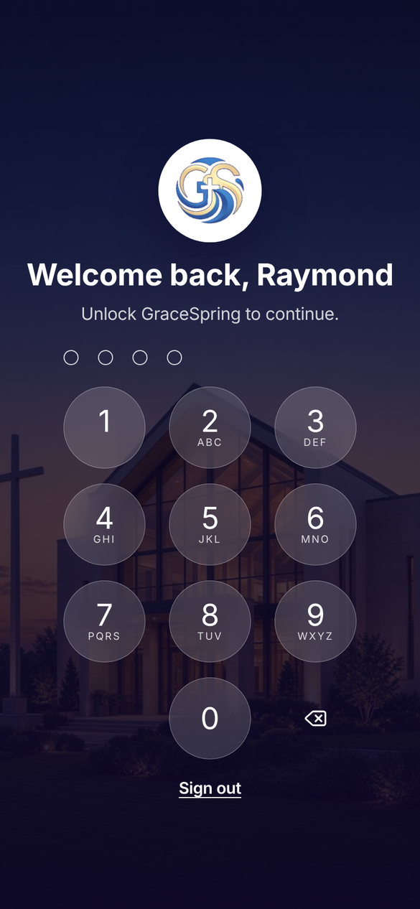 |

Verse cards were removed. Events open from the calendar icon on Home, and Chats sits in the bottom tab bar with Home, Audio and Devotional.

Calls, group chats, ministries and community are parked for later. Their finished screens are in `design/later/` and nothing links to them. The scope is explained in `docs/FEATURES.md`.

## Local development

Requirements: Go 1.25+, Node.js 22.12+, and pnpm 12.9.1.

```sh
pnpm install
cp apps/api/.env.example apps/api/.env  # configure same database as csag
make migrate-up
make dev       # web app
make api       # Go API at 127.0.0.1:8082 (local csag uses 8080)
make build
make lint
make test
make migrate-status  # requires DATABASE_URL and a reachable database
make migrate-up      # applies forward migrations only
make sqlc            # regenerates Go queries from apps/api/sqlc.yaml
```

Copy `apps/api/.env.example` to `apps/api/.env` and set its database URL to the same PostgreSQL database used by csag, with the `app` schema and the `gracespring_app` role. The local csag install currently keeps its tables in `public`, so set `CSAG_AUTH_SCHEMA=public`; production uses `auth`. The API and csag database URLs must share the same host, port, and database name. Their database users and schemas remain separate. The API Make targets read `apps/api/.env`; the file is ignored by git. Grant the API role access only to its own schema and `id,email` on `public.users`, as described in `docs/DEPLOYMENT.md`.

The API verifies tokens locally using the same `AUTH_JWT_SECRET` as csag's `JWT_SECRET`. Copy the value into the API's local env file. Vite reads `VITE_AUTH_BASE_URL` and `VITE_API_BASE_URL` from the root `.env`; `.env.example` has local defaults for csag on port 8080 and the API on port 8082. See `NEXT.md` for the ordered build queue.
